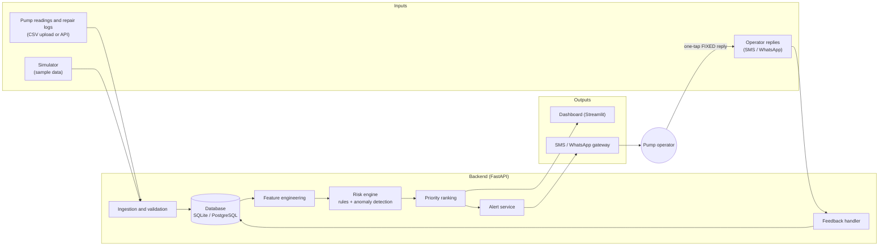
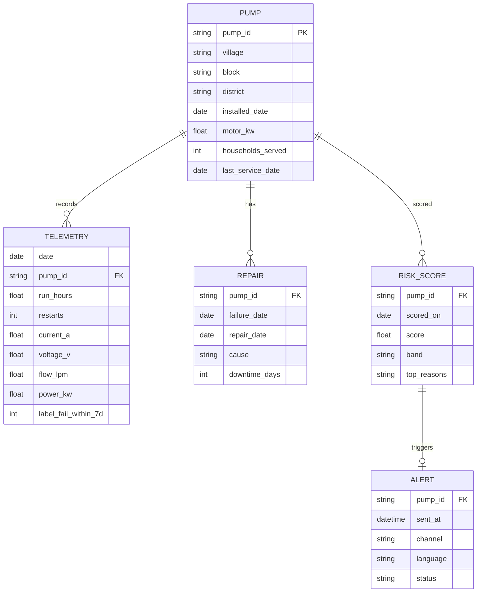
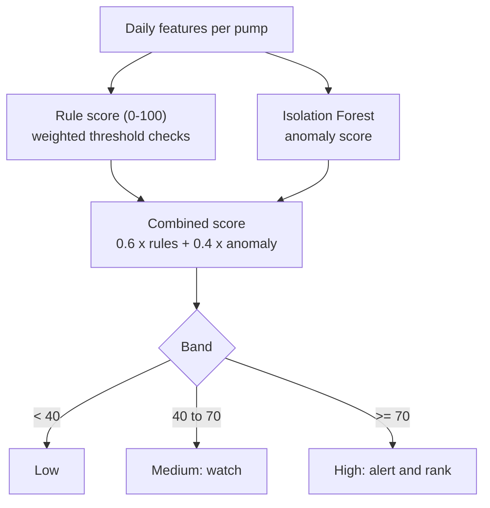
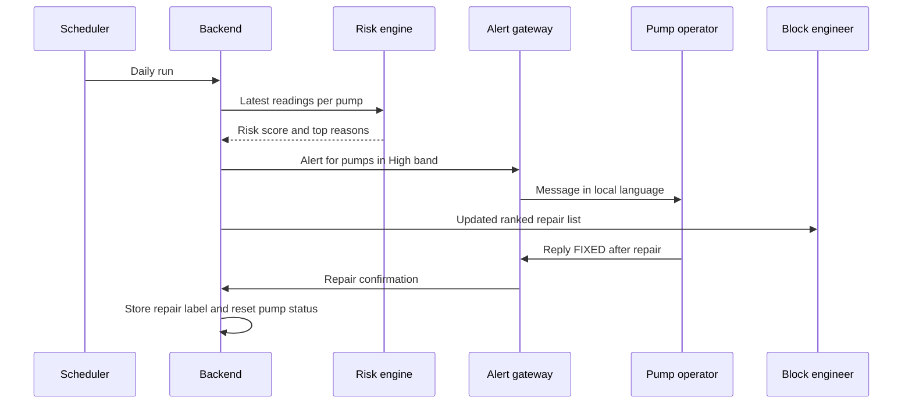

# Technical Design Document

**Project:** Early Failure Warning and Repair Prioritisation for Village Water Pumps
**Team:** [Team Name] · **State/UT:** [State/UT] · **Version:** 1.0 (draft)

## 1. Purpose and scope

Under the Jal Jeevan Mission, many rural households have taps, but supply is interrupted when
village pumps fail. Reviewers describe pump failure as a predictable lifecycle problem. This system
gives panchayat operators and block engineers an early warning and a ranked repair list.

**Goals**
- Flag pumps likely to fail soon, with human-readable reasons.
- Rank pumps so limited repair crews visit the highest-impact pump first.
- Reach operators on channels they already use (SMS/WhatsApp, local language).
- Capture repair confirmations as labelled data.

**Non-goals**
- No claim of certified failure prediction; scores support decisions, they do not replace inspection.
- No hardware design. Real deployments can start from existing meter readings or manual logs.
- Dams, pipelines and water quality are out of scope.

## 2. Users

| User | Need | Interface |
|---|---|---|
| Pump operator (panchayat) | Know which pump needs attention, confirm repairs | SMS / WhatsApp |
| Block / district engineer | Ranked repair list, trends | Web dashboard |
| Gram Panchayat / Pani Samiti | Visibility of supply interruptions | Dashboard summary |

## 3. System architecture

### Components

| Component | Responsibility | Technology |
|---|---|---|
| Ingestion | Validate schema and ranges, store readings | FastAPI, pandas |
| Database | Pumps, telemetry, repairs, scores, alerts | SQLite (default), PostgreSQL (optional) |
| Feature engineering | Baselines, rolling trends, ratios | pandas, numpy |
| Risk engine | Score 0-100 with reasons | scikit-learn (Isolation Forest) + rules |
| Priority ranking | Order pumps for repair | Python |
| Alert service | Templated messages, retry, mock mode | Gateway API (SMS/WhatsApp), mock by default |
| Feedback handler | Parse "FIXED" replies, store repair label | FastAPI webhook |
| Dashboard | Ranked list, pump trend charts | Streamlit |

## 4. Data model

Sample files in `data/sample/` follow the `PUMP`, `TELEMETRY` and `REPAIR` tables. Score and alert tables are created by the application.

## 5. Risk engine

### 5.1 Features (per pump, daily)

| Feature | Meaning | Why it matters |
|---|---|---|
| `current_change_pct` | Last 7 days vs own 30-day baseline | Rising current can indicate motor or winding stress |
| `flow_change_pct` | Last 7 days vs own 30-day baseline | Falling flow can indicate impeller wear or air lock |
| `current_per_flow` | Current divided by flow | Rises when the pump works harder for less water |
| `restarts_per_day` | Mean over last 7 days | Frequent restarts suggest electrical or supply faults |
| `voltage_dips` | Days below a voltage floor | Poor supply stresses motors |
| `days_since_service` | From `last_service_date` | Older service gaps raise risk |

Features are compared with each pump's own baseline, so pumps of different sizes are handled fairly.

### 5.2 Scoring

- The 0.6/0.4 weights and the thresholds (`RISK_THRESHOLD_MEDIUM`, `RISK_THRESHOLD_HIGH`) are starting values to tune.
- Each score stores its top reasons, for example "current +18% vs baseline, restarts 5/day".
- With few real failures, the rule score carries most weight. As confirmed repairs accumulate, they are used to tune weights and thresholds.

### 5.3 Priority ranking

`priority = risk_score × households_served_weight`, with ties broken by days since last service.
This sends limited crews to pumps that are both likely to fail and serve more households.

## 6. Alert and feedback flow

Alert design: one short message per pump, naming the pump, the reason and the requested action;
no more than one alert per pump per day; `ALERT_MODE=mock` logs messages instead of sending them.

## 7. API (planned)

| Method | Path | Purpose |
|---|---|---|
| POST | `/readings` | Upload daily readings (JSON or CSV) |
| GET | `/pumps` | List pumps with latest risk band |
| GET | `/pumps/{pump_id}` | Pump detail, trend and reasons |
| GET | `/ranking` | Ranked repair list (filter by block/district) |
| POST | `/webhook/reply` | Receive operator replies (for example FIXED) |
| POST | `/run-scoring` | Trigger scoring manually |

## 8. Security and privacy

- Secrets are read from environment variables; `.env` is git-ignored.
- Data is operational (pump metrics); operator phone numbers are the only personal data and are stored for alerts only.
- Webhook requests should be verified with a shared secret in a real deployment.
- Dashboard access should be role-based (operator, engineer, admin) before any pilot.

## 9. Evaluation plan

| Metric | Definition |
|---|---|
| Lead time | Days between first High alert and actual failure |
| Recall on simulated failures | Share of failing pumps flagged High at least 3 days before failure |
| False alerts per pump per month | High alerts with no failure within 14 days |
| Operator confirmation rate | Share of repairs confirmed by one-tap reply |
| Social KPIs (pilot) | Supply hours lost per household; time from breakdown to repair; share of repairs done before full failure |

Results on simulated data show only that the pipeline works. Real-world performance needs a pilot.

## 10. Risks and mitigations

| Risk | Mitigation |
|---|---|
| No public real failure data | Simulated data; pilot with one panchayat; confirmations build labels |
| False alarms reduce trust | Conservative thresholds; show reasons; tune with feedback |
| Low digital literacy / language | Local-language SMS/WhatsApp; one-tap replies; no new app |
| Poor connectivity | SMS fallback; sync when online |
| Alerts without repair budget | Ranking prioritises scarce crews; dashboards support O&M planning |

## 11. Deployment

- **Local / demo:** `ALERT_MODE=mock`, SQLite, Streamlit dashboard.
- **Pilot:** PostgreSQL, hosted API, a registered SMS/WhatsApp gateway, scheduled daily scoring.
- **Scale:** per-state configuration, regional-language template sets, integration with existing JJM monitoring data where permitted.

## 12. Limitations and future work

- Thresholds and weights are illustrative until tuned on real data.
- Future: low-cost sensor option, GIS view of pump locations, language packs, integration with state IMIS data where permitted.

## 13. AI tools disclosure

[Fill in the same estimate as the presentation: % AI-assisted, tasks, and that the team reviewed all outputs.]

## 14. References

1. Dept. of Drinking Water & Sanitation, Ministry of Jal Shakti, *Functionality Assessment of Household Tap Connections: National Report 2024*.
2. India Water Portal, *From coverage to functionality: Reviewing India's national assessment of rural tap water services*.
3. CAG, *Performance Audit of Jal Jeevan Mission in Chhattisgarh* (Report No. 2 of 2026).
